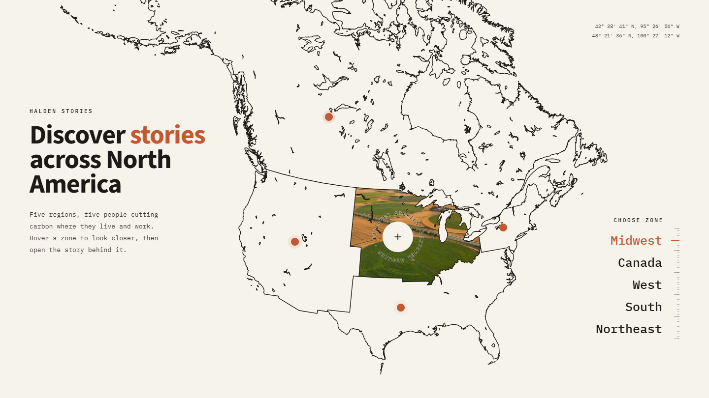
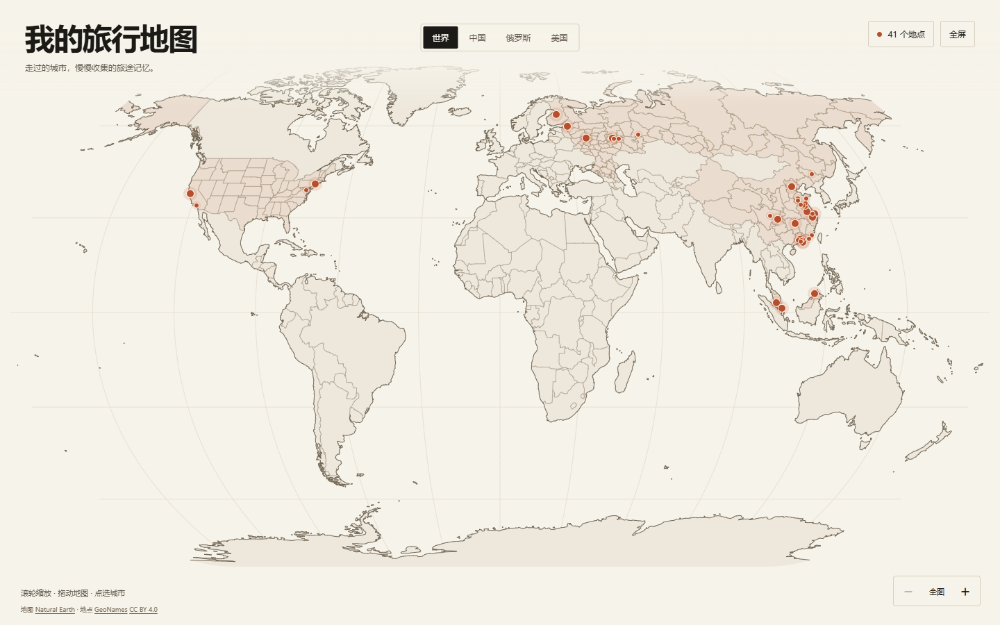

# WebDesign3-LifeMap

两份以真实地理为基础的交互网页作品。Halden Stories 把北美地图作为气候故事的入口，Life Map 用世界地图记录个人旅行足迹。

| 作品 | HTML 文件 |
| --- | --- |
| Halden Stories · 北美气候故事 | [halden-stories.html](halden-stories.html) |
| Life Map · 我的旅行地图 | [travel-map.html](travel-map.html) |

两份作品均使用原生 HTML、CSS、内联 SVG 和 JavaScript。脚本、样式、地图路径与当前展示素材已内嵌在各自的 HTML 文件中。

## Halden Stories



虚构气候刊物 Halden Stories 围绕五个区域、五位从业者展开叙事。地图从地理位置引出人物，将水电、太阳能与风电相关的工作带入一屏可探索的界面。

暖纸色 `#F6F3EA`、墨色 `#1C1A17` 与陶土色 `#C35933` 构成地图底色。Source Sans 3 的粗体标题搭配 IBM Plex Mono 的坐标、区域标签和正文，形成田野笔记式的地图集观感。故事卡片分别使用钴蓝、墨黑、陶土、森林绿和芥末黄。

地图采用 Lambert 等角圆锥投影，由公开地理数据生成美国、加拿大与湖泊轮廓，并将美国各州合并为四大 Census 区域。细线绘入、湖岸和岛屿共同构成地图层次。

### 交互

- 悬停区域、圆点或右侧名称，切换影像填充、坐标、文字高亮和标尺位置。
- 点击区域进入故事，地图向左退场，横向影像面板与彩色人物卡片滑入。
- 拖动故事轨道，体验惯性与吸附切换。左右方向键切换故事，`Esc` 或 Back 返回地图。
- 手机使用底部区域标签和上下排列的故事版式。

动态风景通过一个循环视频提供。Canvas 按格裁切视频帧，再由 SVG 区域轮廓裁切成地图填充；静态图承担视频就绪前的显示。人物卡片配合照片揭示、文字错峰进入和轻微视差。

## Life Map · 我的旅行地图



以全屏地图承载 41 个旅行足迹。18 个地点提供简介和代表性参考照片，23 个地点以简洁标记呈现。地点可以使用城市、地区或国家的代表坐标，旅行时间和个人故事保留为可填写字段。

页面延续暖纸色、细墨线与陶土色圆点，详情卡使用森林绿 `#234638`。中文采用系统无衬线字体，照片序号等辅助数字使用等宽字体。地图主体保持开阔，地点列表和详情在需要时展开。

世界地图采用 Natural Earth 1 投影，包含南极洲。中国省级行政区、美国州与俄罗斯联邦主体的内部边界来自公开行政区划数据，并裁切到当前地图的国家轮廓内。

### 交互

- 在世界、中国、俄罗斯和美国视图之间切换。
- 滚轮围绕指针位置缩放，按住并拖动地图，或使用右下角的缩放与全图按钮。
- 点击足迹或展开地点列表，选择地点后查看简介、故事和照片。
- 聚焦地图后，方向键平移，`+` / `-` 缩放，`0` 返回全图；`Esc` 关闭详情和地点列表。
- 窄屏中，地点详情显示为底部卡片。

### 博客中的紧凑入口

给页面地址添加 `?embed=1`，显示适合博客栏目使用的小地图入口。点击入口会在新标签页打开完整地图。

```html
<iframe
  src="travel-map.html?embed=1"
  title="我的旅行地图"
  width="100%"
  height="420"
  style="border: 0"
  loading="lazy">
</iframe>
```

将 `src` 调整为博客中实际可访问的 HTML 路径。

## 下载与打开

1. 在仓库页面选择 **Code → Download ZIP**，然后解压。
2. 用现代浏览器打开 `halden-stories.html` 或 `travel-map.html`。
3. 文件可直接运行，无需安装依赖或执行构建。

## 修改旅行地点

用文本编辑器打开 `travel-map.html`，搜索 `id="travel-data"`。这个 JSON 数据块中的 `title`、`subtitle` 和 `places` 控制页面标题与足迹内容。

| 字段 | 用途 |
| --- | --- |
| `id`、`name`、`country` | 稳定标识、显示名称与所属国家或地区文字 |
| `lat`、`lon` | 十进制度纬度与经度 |
| `countryCode` | 三位数字字符串，用于匹配地图轮廓，如中国 `"156"`、美国 `"840"` |
| `region` | `"cn"` 归入中国视图，其他地点使用 `"world"` |
| `detail` | `true` 开启详情，`false` 使用简洁足迹标记 |
| `when`、`intro`、`story` | 旅行时间、地点简介与个人旅行记录 |
| `photos` | 照片数组，每张可填写 `src`、`alt` 和 `caption` |

例如，可在现有北京条目中填写个人记录和照片。

```json
{
  "id": "beijing",
  "name": "北京",
  "country": "中国",
  "countryCode": "156",
  "lat": 39.9075,
  "lon": 116.39723,
  "region": "cn",
  "detail": true,
  "when": "",
  "intro": "",
  "story": "",
  "photos": [
    {
      "src": "photos/beijing.jpg",
      "alt": "北京旅行照片",
      "caption": ""
    }
  ]
}
```

照片可使用相对路径、HTTPS 链接或 data URL。使用相对路径时，将对应图片放在 HTML 所在目录的相应位置。多张照片按数组顺序切换，空数组 `[]` 可保留纯文字详情。JSON 字符串中的换行使用 `\n`。

## 素材与来源

- 世界地图、湖泊与行政区划使用 Natural Earth 公共领域数据。北美地图另使用 us-atlas 中的美国 Census 地理数据；国家数据经 world-atlas 分发。[Natural Earth 使用条款](https://www.naturalearthdata.com/about/terms-of-use/) · [us-atlas](https://github.com/topojson/us-atlas) · [world-atlas](https://github.com/topojson/world-atlas)
- 地点坐标与地名资料使用 GeoNames，并保留 CC BY 4.0 署名。地图页内也提供数据来源链接。[GeoNames 数据说明](https://download.geonames.org/export/dump/readme.txt) · [CC BY 4.0](https://creativecommons.org/licenses/by/4.0/)
- 旅行地图预置照片为城市或地区的代表性参考图。照片作者、原作链接、许可类型及缩放压缩说明已写入 HTML，并在相应地点详情中展示。使用照片时请遵循各自标明的许可。
- Halden Stories 内嵌 Source Sans 3 与 IBM Plex Mono 字体，并在文件内保留字体许可说明。
- Halden Stories 的风景、人物照片和循环视频来自项目提供的原始素材，其复用授权以原始素材权利人的许可为准。
